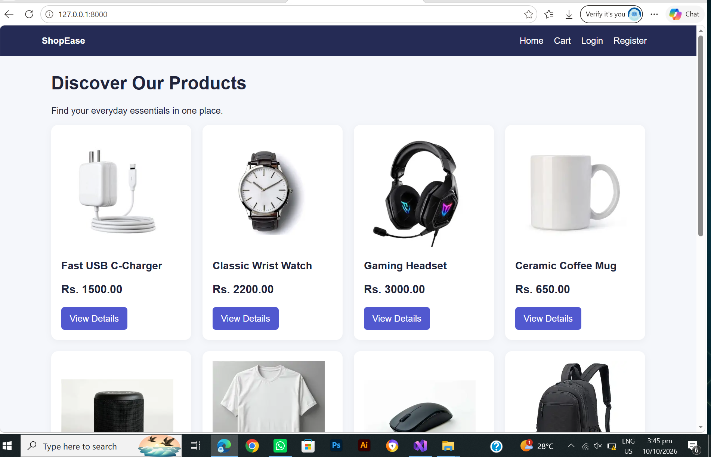
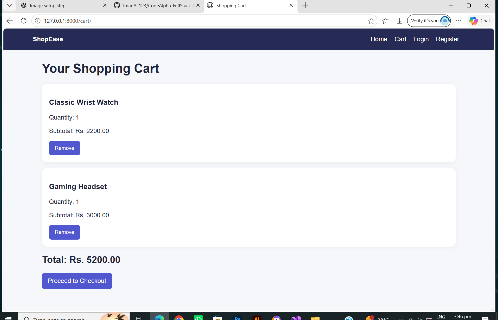
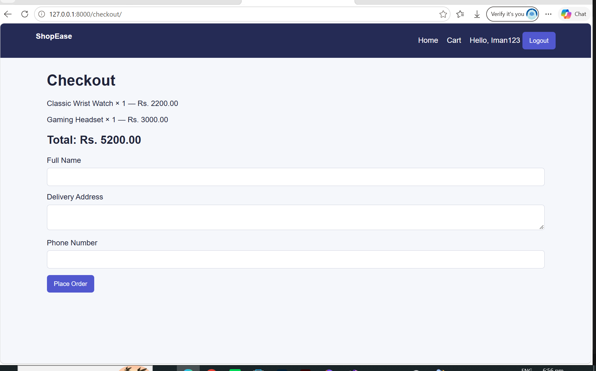

# ShopEase — E-Commerce Web Application

**Task 1 | CodeAlpha Full Stack Development Internship**

ShopEase is a Django-based e-commerce web application developed as part of my CodeAlpha Full Stack Development internship project. It provides a simple online shopping experience where users can browse products, view product details, add items to a shopping cart, and place orders.

## Project Overview

The main goal of ShopEase is to demonstrate practical full-stack web development skills using Django, Python, HTML, CSS, and a database.

The project includes product management, user authentication, shopping cart functionality, and an order checkout process.

## Features

- **Product Listing:** Browse available products on the home page.
- **Product Details:** View individual product information.
- **Shopping Cart:** Add products to the cart and manage selected items.
- **Checkout:** Enter customer details and place an order.
- **User Authentication:** Register, log in, and log out.
- **Order Management:** Store order information and track order status.
- **Admin Panel:** Manage products and review orders through Django Admin.
- **Product Images:** Display product-specific images.
- **Database Integration:** Store product and order information.

## Technologies Used

- **Backend:** Python, Django
- **Frontend:** HTML, CSS, Django Templates
- **Database:** SQLite
- **Development Tools:** Visual Studio Code, Git, GitHub

## Project Structure

```text
Task-1/
├── config/
│   ├── settings.py
│   ├── urls.py
│   ├── asgi.py
│   └── wsgi.py
├── store/
│   ├── migrations/
│   ├── admin.py
│   ├── models.py
│   ├── tests.py
│   ├── urls.py
│   └── views.py
├── templates/
│   ├── registration/
│   └── store/
├── static/
│   └── images/
├── screenshots/
├── manage.py
├── requirements.txt
└── README.md
```

## Installation and Setup

Follow these steps to run the project locally.

### 1. Clone the Repository

```bash
git clone https://github.com/ImanAli123/CodeAlpha-FullStack-Projects.git
```

### 2. Navigate to Task-1

```bash
cd CodeAlpha-FullStack-Projects/Task-1
```

### 3. Create a Virtual Environment

```bash
python -m venv venv
```

Activate it on Windows PowerShell:

```powershell
.\venv\Scripts\Activate.ps1
```

### 4. Install Dependencies

```bash
python -m pip install -r requirements.txt
```

### 5. Apply Database Migrations

```bash
python manage.py migrate
```

### 6. Create an Admin Account (Optional)

```bash
python manage.py createsuperuser
```

Follow the prompts to set up your admin account.

### 7. Start the Development Server

```bash
python manage.py runserver
```

Open the following URL in your browser:

http://127.0.0.1:8000/

The Django administration panel is available at:

http://127.0.0.1:8000/admin/

## Screenshots

Screenshots of the application are available in the `screenshots/` directory.

### Homepage



### Shopping Cart



### Checkout Page



## Learning Outcomes

Through this project, I gained practical experience in:

- Developing web applications with Django.
- Creating database models and managing migrations.
- Implementing user registration and authentication.
- Building product listing and detail pages.
- Working with shopping cart and checkout workflows.
- Organizing static files, templates, and project structure.
- Using Git and GitHub for version control and project sharing.

## Future Improvements

- Integrate an online payment gateway.
- Add product search, filtering, and sorting.
- Improve the user interface and responsive design.
- Add order history and enhanced order tracking.
- Deploy the application to a production hosting platform.

## Author

**Iman Ali**

- GitHub: [ImanAli123](https://github.com/ImanAli123)
- LinkedIn: [Iman Ali](https://www.linkedin.com/in/iman-ali0/)

## Internship

Developed as **Task 1** for the CodeAlpha Full Stack Development internship project series.

---

*This project was created for learning and demonstration purposes.*
